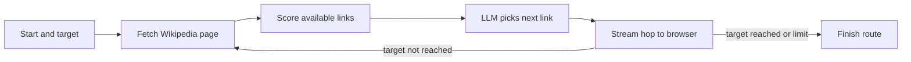

<div align="center">
  

  <a href="https://readme-typing-svg.demolab.com"></a>

  <p>
    
    
    
    <a href="LICENSE"></a>
  </p>
</div>

## 🗺️ What it does

WikiRun asks an LLM to navigate from a starting Wikipedia topic to a target by choosing among links on the current article. The backend fetches article summaries and links from Wikipedia, sends progress over a WebSocket, and caches page and run data when MongoDB is configured.

## 🔄 A run



## 🧠 Selection and fallback

- The backend supplies the current article's candidate links to its configured chat-completion endpoint.
- FastEmbed embeddings and scikit-learn TF-IDF/cosine similarity are available in the project for semantic fallback and scoring.
- A small in-process LRU cache reduces repeated page fetches. MongoDB adds page/run caches with TTL indexes when `MONGODB_URI` is configured.
- The frontend renders the streamed route and article transitions.

## 🧰 Stack

| Part | Tools |
|---|---|
| API | Python, FastAPI, Uvicorn, HTTPX |
| Wikipedia | MediaWiki Action API |
| Link scoring | FastEmbed, NumPy, scikit-learn |
| Model endpoint | OpenAI-compatible endpoint; Groq/Moonshot settings in backend |
| Cache | In-memory LRU, optional MongoDB |
| Client | Static HTML/CSS/JavaScript, WebSocket |

## 🚀 Run locally

```bash
git clone https://github.com/ChristopherJoshy/WikiRun.git
cd wikirun/backend
python -m venv .venv
# Windows: .venv\Scripts\Activate.ps1
# macOS/Linux: source .venv/bin/activate
pip install -r requirements.txt
```

Set `GROQ_API_KEY` or `MOONSHOT_API_KEY` in a local environment. `MONGODB_URI` is optional; without it the app uses its in-process cache. Start the API:

```bash
uvicorn app:app --reload --port 8000
```

Then serve `frontend/` with a static HTTP server and point its API/WebSocket settings at the backend. The backend currently permits broad CORS origins for development; configure that before a public deployment.

## 🗂️ Layout

```text
backend/app.py   Wikipedia fetching, caching, scoring, LLM hop selection, WebSocket API
frontend/        browser interface and route visualization
```

## 📄 License

MIT. See [`LICENSE`](LICENSE).

## ⚠️ Notes

The Wikipedia API and model provider are external dependencies. Runs are bounded by a maximum-hop setting and provider/network availability; this is an exploratory route finder, not a guarantee of the shortest path.